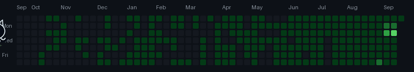

  
 

  
# 💫 About Me:
   
  
### I'm **Pulkit Singh** a software developer, technical writer, and open-source community contributor with experience across web development, cloud computing, AI-powered applications, developer tooling, and developer advocacy. My background includes full-stack development, technical content creation, open-source initiatives, and community leadership. I have worked with development teams, contributed to technical communities, published educational content, and participated in developer events through speaking, mentoring, judging, and organizing.  

## `~/professional_experience`  
- **Technical Author — freeCodeCamp:** Authored technical articles covering online safety and developer communities. 
- **Contract Technical Writer — KubeSphere:** Worked on technical writing within the cloud-native ecosystem. 
- **Full-Stack Developer Intern — TechVraksh:** Collaborated with the development team on full-stack web development. 
- **Web Developer / Designer — Google Educator Groups (Ahmedabad & Pune):** Contributed to responsive website development and design. 
- **Web Developer / Volunteer — Google Developer Group Chandigarh:** Contributed to website development and supported community events.  

## `~/open_source_and_community`  
- **Founder & Lead Organizer — Programmers Universal Group (PUG):** Built a developer community of 800+ members. 
- **Community Organizer — CNCF:** Participated in cloud-native community initiatives. 
- **Mozilla Volunteer / Facilitator:** Contributed to community programs and developer engagement. 
- **DeepLearning.AI Ambassador:** Participated in AI-focused community initiatives. 
- **Data on Kubernetes Community:** Contributed through community involvement and technical activities. 
- **Major League Hacking:** Previous organizer and Guild Leader involvement. 
- **TensorFlow User Group Chandigarh:** community organization and assistant organizer involvement. 
- **TechTogether:** Mentored participants across multiple hackathon events. 
- **Hackathon Community:** Previous experience as a mentor, judge, speaker, and organizer at developer events.  

## `~/recognition`  
- Linux Foundation LiFT Scholarship recipient. 
- Microsoft Azure Hero. 
- Postman API Student Expert. 
- DeepLearning.AI event ambassador. 
- Hackathon winner and scholarship recipient across earlier developer events. 
- Speaker at React India 2021.  

## `~/elsewhere`  
-  
-  
- [Hashnode](https://hashnode.com/@PulkitSingh) 
- [Devfolio](https://devfolio.co/@pulkitsinghdev) 
- 
- 
- 
---
  
Experience and affiliations listed above reflect previous roles and activities; not all are current appointments. Technology names represent tools used or explored across my historical work, not a claim of equal proficiency in every stack. 

# 💻 Tech Stack:
                                                                         
# 📊 GitHub Stats:

### ✍️ Random Dev Quote

---

  ## 💰 You can help me by Donating
   

  ---

  
 

