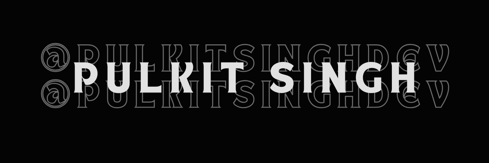

  

<h1 align="center">print("Hey, there!") 👋</h1>

  Software developer · Technical writer · Open-source community contributor

  <a href="https://pulkitsinghdev.github.io">Portfolio</a> ·
  <a href="https://linkedin.com/in/pulkitsinghdev">LinkedIn</a> ·
  <a href="https://dev.to/pulkitsinghdev">DEV</a> ·
  <a href="https://github.com/PulkitSinghDev">GitHub</a>

## 👨‍💻 About me

I build software, write about technology, and contribute to developer communities. I’m currently growing my experience in open source and cloud-native projects, and enjoy helping people learn through practical, beginner-friendly resources.

- 🌱 Currently learning: Python, cloud-native development, and open-source project workflows
- 🔭 Interested in: developer tools, AI, web development, and cloud-native infrastructure
- ✍️ Technical writing: [freeCodeCamp](https://www.freecodecamp.org/news/author/pulkitsingh/)
- 🤝 Community: Founder and lead organizer of [Programmers Universal Group](https://github.com/ProgrammersUniversalGroup)
- 🌐 Portfolio: [pulkitsinghdev.github.io](https://pulkitsinghdev.github.io)

## 🧭 Experience & community

- Technical author at freeCodeCamp
- Technical writer with KubeSphere
- Full-stack development intern at TechVraksh
- Founder and lead organizer of Programmers Universal Group
- Contributor to developer communities and events through writing, mentoring, speaking, and organizing

## 🛠️ Languages and tools

  
  
  
  
  
  
  

## 📊 GitHub at a glance

  
  

## 🤝 Connect with me

- 🌐 [Website](https://pulkitsinghdev.github.io)
- 💼 [LinkedIn](https://linkedin.com/in/pulkitsinghdev)
- 📝 [DEV Community](https://dev.to/pulkitsinghdev)
- 🐙 [GitHub](https://github.com/PulkitSinghDev)
- 📷 [Instagram](https://instagram.com/pulkitsig)
- 💻 [CodePen](https://codepen.io/pulkitsinghdev)

---

<i>Open source and community are great ways to learn, build, and help others.</i>

